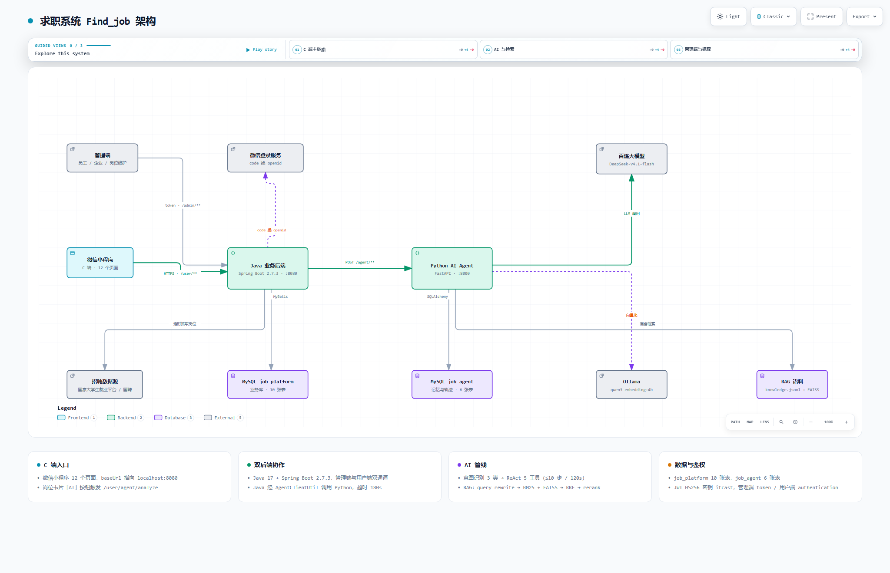

# 求职系统 Find_job

面向国企 / 央企求职场景的一站式系统：**Spring Boot 业务平台 + Python AI Agent + Web 前端 + 微信小程序**。
覆盖岗位检索与缓存、简历投递、收藏、AI 岗位推荐 / 简历优化 / 求职问答，以及后台管理与数据采集。



## 一、模块组成

| 模块 | 技术栈 | 默认端口 | 职责 |
| --- | --- | --- | --- |
| [job-platform](job-platform) | Java 17、Spring Boot 2.7、MyBatis、MySQL、Redis、JWT | 8080 | 用户/岗位/简历/投递/收藏、管理端、岗位缓存、爬虫 |
| [job-agent](job-agent) | Python 3.11+、FastAPI、LangChain / LangGraph、FAISS + BM25 | 8000 | 意图识别、ReAct 工具调用、RAG、短期/长期记忆、评测 |
| [job-web](job-web) | 原生 HTML/CSS/JS、nginx | 81 | 求职端页面与 nginx 部署配置（限流、反向代理） |
| [job-miniprogram](job-miniprogram) | 微信小程序 | — | 移动端岗位浏览、投递、收藏 |
| [archify](archify) | 架构图源文件 | — | 系统架构图（HTML / PNG） |
| [docs](docs) | Markdown | — | 官方招聘渠道等资料 |

## 二、核心能力

### 岗位平台（job-platform）

- **岗位详情缓存**：Redis 逻辑过期 + 旧值兜底；后台刷新走**有界线程池**，同一岗位用**Redis 分布式锁**去重，拿锁后二次校验是否仍需刷新。
- **缓存一致性**：先更新数据库，再按岗位清理缓存；管理端与爬虫都会触发失效。
- **投递**：登录身份取自 JWT（`BaseContext`），不信任请求参数；重复投递由唯一键兜底；插入投递与岗位计数在同一事务中。
- **AI 分析去重**：同一「用户 × 岗位」分析结果缓存 6 小时；未命中时用锁保证只有一次大模型调用，其余请求等缓存，等不到才降级自算。
- **鉴权**：用户端 / 管理端两套 JWT 密钥与拦截器，接口按角色隔离。
- **定时爬虫**：抓取国企岗位并按标题 + 企业去重入库。

### AI Agent（job-agent）

- **链路**：入口硬规则 → 意图识别 → 编排 → ReAct（按意图收窄工具）→ 终止条件（步数 / 超时 / 预算）。
- **工具**：`search_jobs`、`get_user_resume`、`get_user_applications`、`search_knowledge`。
- **记忆**：短期存 Redis（最近 30 轮原话，会话级互斥与租约）；每新增 5 轮尝试提取摘要与用户画像，写入 MySQL `user_profile`。
- **RAG**：Query Rewrite → BM25 + FAISS 混合召回 → Rerank → Top-K。
- **可观测与评测**：`agent_trace` 记录每步；200 条评测集，覆盖路由、工具、检索、回答质量、稳定性五类指标。

### 前端与部署（job-web）

- 页面通过 `/api/` 访问后端，nginx 做**令牌桶限流**（超限 429 + 统一 JSON 错误体）、长请求超时放宽、静态资源缓存。
- 一键启动脚本见根目录 `一键启动求职系统.bat`。

## 三、快速开始

### 环境要求

- JDK 17、Maven 3.8+
- Python 3.11+
- MySQL 8.0、Redis 6+
- nginx（可选，纯看页面也可直接用静态服务器）

### 1. 初始化数据库

```bash
mysql -uroot -p < job-platform/sql/schema.sql    # 求职业务库 job_platform
mysql -uroot -p < job-agent/sql/schema.sql       # Agent 库 job_agent
```

### 2. 配置

```bash
# 后端：由模板生成本地配置（含密钥，已被 .gitignore 忽略）
copy job-platform\job-server\src\main\resources\application-dev.example.yml `
     job-platform\job-server\src\main\resources\application-dev.yml

# Agent
copy job-agent\.env.example job-agent\.env
```

需要填写：MySQL 账号密码、Redis 地址、JWT 密钥、阿里云 OSS（简历附件）、微信 appid/secret、模型 API Key。

### 3. 启动

```bash
# 后端（8080）
cd job-platform
mvn -pl job-server spring-boot:run

# Agent（8000）
cd job-agent
pip install -r requirements.txt
python -m app.main

# 前端（可选，nginx 81）
cd job-web
nginx -c %cd%/deploy/nginx.conf
```

小程序：用微信开发者工具导入 `job-miniprogram`，在 `config.js` 中把接口地址改为本机或局域网 IP。

## 四、目录结构

```
Find_job/
├── job-platform/            # Spring Boot 业务平台
│   ├── job-common/          # 通用工具、JWT、Redis 锁、OSS
│   ├── job-pojo/            # 实体与 VO/DTO
│   └── job-server/          # 控制器、服务、Mapper、配置
├── job-agent/               # AI Agent 服务
│   ├── app/api/             # chat / recommend / analyze / memory 接口
│   ├── app/core/            # 意图、编排、ReAct 管线、终止条件
│   ├── app/memory/          # Redis 短期记忆、摘要、画像
│   ├── app/rag/             # 索引、混合检索、改写、重排
│   ├── app/tools/           # 工具注册与实现
│   ├── benchmark/           # 评测集、指标、裁判、回归
│   └── tests/               # 单元测试
├── job-web/                 # 前端页面 + nginx 部署
├── job-miniprogram/         # 微信小程序
├── docs/                    # 架构图、招聘渠道资料
└── 求职系统完整文档.md        # 需求与设计说明
```

## 五、测试与评测

```bash
# Agent 单测
cd job-agent && python -m pytest tests

# 评测（需先准备评测集与模型配置）
cd job-agent && python -m benchmark.evaluate

# 前端 / 小程序校验脚本
cd job-web && python tests/<脚本>
```

评测指标：路由准确率、工具调用 P/R/F1、Recall@K / Hit@K、Faithfulness、Context Recall、任务完成率、对抗样本完成率、延迟与错误率。

## 六、安全与配置说明

- **密钥不入库**：`application-dev.yml`、`.env` 已加入 `.gitignore`，仓库只提交占位模板。
- 生产配置 `application.yml` 全部通过环境变量注入。
- 上传接口限制 10 MB，仅允许图片/文档类型。

## 七、相关文档

- [求职系统完整文档](求职系统完整文档.md)
- [Agent 详细说明](job-agent/README.md)
- [Web 部署与限流说明](job-web/README.md)
- [官方招聘网站清单](docs/官方招聘网站清单.md)
- [系统架构图（可交互）](archify/求职系统架构图.html)

## 八、License

代码用于个人求职项目展示与学习交流；第三方依赖遵循各自许可证。
