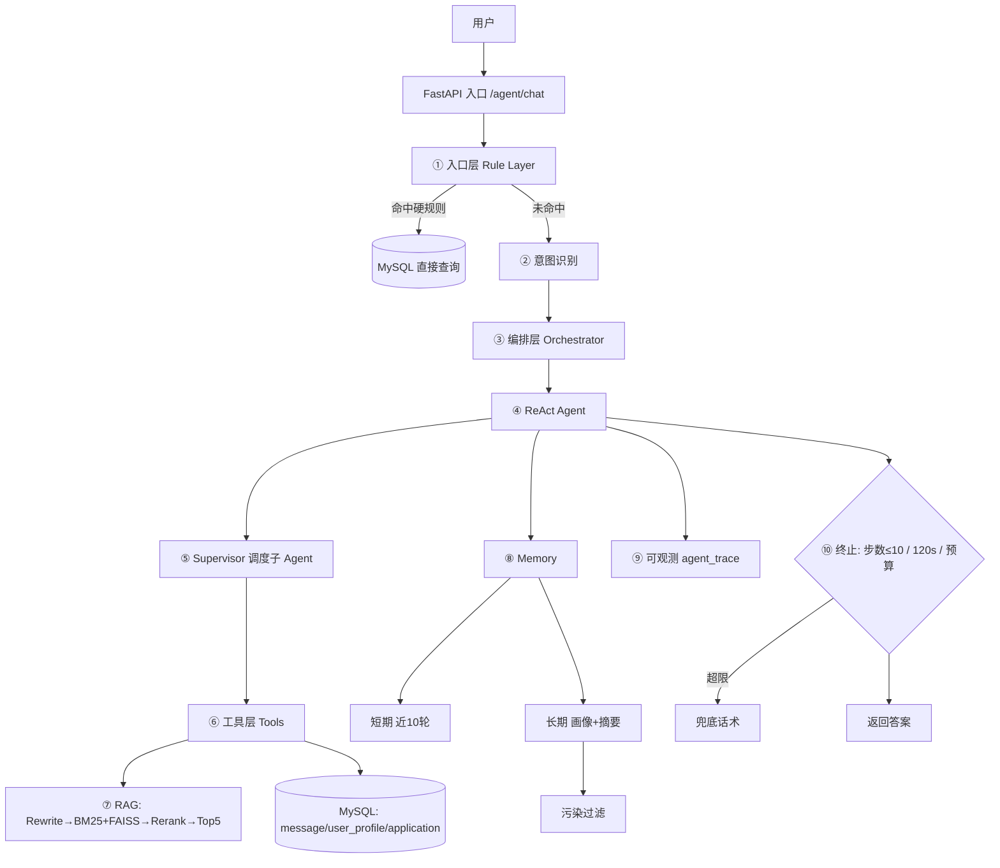

# 求职系统 AI Agent

面向求职管理系统的智能体服务：岗位推荐、简历优化、求职问答。
与现有后端（`job-platform`）解耦，通过 HTTP 提供 `/agent/chat`、`/agent/recommend` 等接口。

**技术栈**：以 LangChain + LangGraph 为基座 —— 模型走 `BaseChatModel`、工具走 `@tool`、ReAct 走 `create_react_agent`、记忆走 `BaseChatMessageHistory`、RAG 走 `FAISS`/`BM25Retriever`、Workflow 走 `StateGraph` + `interrupt`。

## 目录结构

```
job-agent/
├── README.md
├── requirements.txt
├── .env.example
├── sql/schema.sql                    # MySQL 建表
├── app/
│   ├── main.py                       # FastAPI 入口
│   ├── config.py                     # 配置
│   ├── api/
│   │   ├── schemas.py                # Pydantic 请求/响应
│   │   └── routes/
│   │       ├── agent.py              # chat / recommend
│   │       ├── memory.py             # 记忆修正接口
│   │       └── benchmark.py          # 评测触发
│   ├── core/
│   │   ├── entry_rule.py             # ① 入口层：硬规则拦截
│   │   ├── intent.py                 # ② 意图识别
│   │   ├── orchestrator.py           # ③ 编排层（当前均 ReAct）
│   │   ├── supervisor.py             # ④ Multi-Agent Supervisor
│   │   └── termination.py            # 终止条件
│   ├── agents/
│   │   ├── react_agent.py            # ReAct Agent（create_react_agent）
│   │   └── sub_agents.py             # 子 Agent 定义
│   ├── tools/
│   │   ├── registry.py               # 工具注册表
│   │   ├── job_tools.py              # search_jobs
│   │   ├── resume_tools.py           # get_user_resume
│   │   ├── application_tools.py      # get_user_applications
│   │   ├── knowledge_tools.py        # search_knowledge (RAG)
│   │   └── memory_tools.py           # save_conversation
│   ├── rag/
│   │   ├── embeddings.py             # embedding 抽象
│   │   ├── indexer.py                # 建索引 + Chunk Size A/B
│   │   ├── hybrid_retriever.py       # BM25 + FAISS
│   │   ├── query_rewrite.py          # Query Rewrite
│   │   └── rerank.py                 # Rerank
│   ├── memory/
│   │   ├── short_term.py             # 短期记忆（近 10 轮）
│   │   ├── long_term.py              # 长期记忆（画像/摘要）
│   │   ├── summarizer.py             # 每 5 轮摘要
│   │   ├── filter.py                 # 记忆污染过滤
│   │   └── repair.py                 # 摘要错误修复
│   ├── llm/
│   │   ├── factory.py                # Provider 工厂（返回 langchain BaseChatModel）
│   │   └── retry.py                  # 错误分类 + 重试
│   ├── db/
│   │   ├── session.py                # SQLAlchemy async（懒加载引擎）
│   │   ├── models.py                 # ORM
│   │   └── repositories.py           # CRUD
│   └── observability/
│       ├── tracer.py                 # agent_trace 可观测性（管线级）
│       └── callback.py               # LangChain 回调：token/工具/检索采集
├── benchmark/
│   ├── dataset/sample.jsonl          # 样例评测集
│   ├── evaluate.py                   # 评测主脚本
│   ├── metrics.py                    # 指标计算
│   ├── judge.py                      # LLM-as-a-Judge
│   ├── report_template.md            # 报告模板
│   └── regression.py                 # 回归机制
└── tests/
    └── test_memory_filter.py
```

## 架构图（Mermaid）



## 核心设计决策

| 问题 | 决策 |
| --- | --- |
| ReAct vs Workflow | 当前业务均为路径未知型任务，统一 ReAct；若后续有步骤固定/合规强的任务再引入 Workflow（见 `orchestrator.py` 划分标准） |
| 记忆 | 短期=近 10 轮原样对话；长期=画像/偏好/跨会话摘要；敏感凭证/闲聊/他人数据**绝不入长期** |
| 摘要修复 | 用户反馈按钮 + 定期评测回溯 + 手动修正接口（`memory/repair.py`） |
| 模型适配 | 基于 LangChain `BaseChatModel`，Provider 工厂统一切换 OpenAI/Anthropic/Gemini/Qwen，消息 Schema 用 LangChain 原生 `BaseMessage` |
| 高并发 | 无状态 Agent + 有界并发 + 超时/预算熔断 + 只读检索走缓存（见 Supervisor 章节） |

## 快速开始

```bash
cd job-agent
python -m venv .venv && source .venv/bin/activate   # Windows: .venv\Scripts\activate
pip install -r requirements.txt
cp .env.example .env                                  # 填入 MySQL / 模型配置
mysql -uroot -p < sql/schema.sql                      # 建表
python -m app.main                                    # 启动 :8000
```

调用：

```bash
curl -X POST http://localhost:8000/agent/chat \
  -H 'Content-Type: application/json' \
  -d '{"user_id":1,"message":"帮我推荐北京的国企算法岗"}'
```

---

## 面试话术要点（30 秒版本）

1. **链路**：入口硬规则拦截（防幻觉、省成本）→ 意图识别 → 编排路由（ReAct 给开放任务，Workflow 给合规固定流程）→ 工具层 → RAG 混合检索 → 双记忆 → 全链路 agent_trace 可观测 → 终止条件兜底。
2. **ReAct 边界**：只要「路径确定、需要幂等、合规强」就不给 ReAct。ReAct 每步都进 trace、限制步数/超时/预算。
3. **记忆**：短期存最近 10 轮原话，长期只存「经过过滤的画像+摘要」；摘要靠用户反馈 + 评测回溯 + 手动接口三重修复。
4. **RAG**：召回率与忠实率/正确率分离评估，Chunk Size 做 A/B；混合检索 + Rerank 保 top5 质量。
5. **对抗性**：评测集里放「前提错误/超范围/自相矛盾」，Agent 必须纠正而非逢迎。
6. **高并发**：Agent 无状态、工具幂等、RAG 走缓存、并发有界 + 超时预算熔断。
